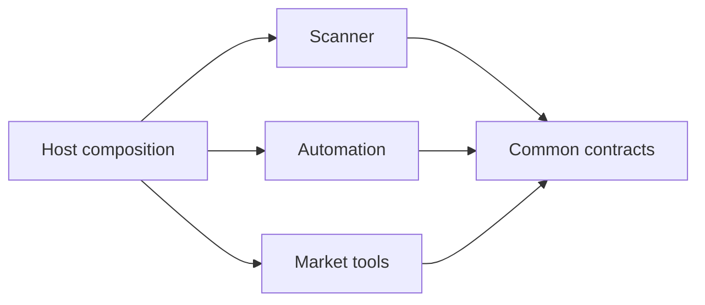

# Architecture

Crowley has four independently built component distributions and one small host application.
The scanner and automation have separate Python namespaces, WoW addons, configuration and
lifecycle. Neither component imports the other. The market server installs no desktop stack.

| Owner | Responsibility |
|---|---|
| packages/common/src/crowley_common | House/item/scan/frame contracts, selected target/catalog metadata, private paths and Lua serialization |
| packages/market/src/crowley_market | Ingestion, retained history/analysis, main dashboard, recipe watch, migrations and backup/restore |
| packages/scanner/src/crowley_scanner | Scanner addon/resources, SavedVariables parsing, companion uploads and acknowledgements |
| packages/automation/src/crowley_automation | Desktop observation/input/launch, independent game addon, exact operations, ledger and measured movement |
| apps/host/src/crowley_host | Configuration/install/diagnosis and explicit scan-aware composition |

The common package has no component runtime dependencies. Market and scanner depend on
common. Automation depends on common and desktop libraries, with no catalog resolution,
scanner implementation, HTTP client or market DB dependency. Only host composes components.
Tests check these import directions and installed wheel/sdist resource ownership. Resources
belong to their package and never resolve through a source checkout.

Scanner collection runs in the Crowley addon. Crowley_Data contains only its immutable
scan plan, acknowledgement IDs and generation time. The installed scanner name and
CrowleyDB SavedVariables identity are preserved. A human can open the AH and collect
without automation installed. Starts are scheduled 900 seconds apart; each query and sweep
has its target-defined budget, and cold items rotate through six recorded slices. Query
freshness barriers retain distinctions between attempted, incomplete, empty and priced.

The scanner saves compressed observations in CrowleyDB.scans. The game writes SavedVariables
at reload/logout/exit. The companion parses original bytes, uploads idempotently and writes
Data.lua acknowledgements. Loading acknowledgements at the next reload prunes in-memory
pending data; a later flush establishes disk cleanup. At six pending sweeps the scanner
pauses and never evicts evidence. Transport state v3 contains uploaded/probe/rejection
records only; its explicit v2 migration preserves the retained fields and removes retired
workflow state. There is no execution queue or Queue.lua transport.

Market ingestion accepts historical format 2 and current format 3. Plans retain their
canonical JSON and hash. Item variants use canonical itemKey; houses are never mixed.
Commodity prices are integer unit copper; format 3 grouped non-commodity buyout is per
auction, with quantity retained as availability. Historical format 2 non-commodity rational
prices are normalized at storage without rewriting the received payload/archive digest.
Coverage ceilings need a strictly higher witness to be bounded; exactly N retained levels
with complete source coverage are full. Exact wrapped uint32 time-left values decode only
inside the documented negative window. Unknown identity or incomplete coverage never
becomes zero supply or a guessed sale. See [ANALYSIS](ANALYSIS.md).

All twelve applied SQL migrations retain their original bytes. Retiring an API removes
its runtime consumers, not historical tables or raw evidence. New schema changes require
a new numbered migration. Backup checks bind an exact pinned server image and migration
inventory before dumping. Legacy manifests select the legacy package explicitly; new
snapshots require the new image contract. See [MARKET_RECOVERY](MARKET_RECOVERY.md).

Scanner and automation publish independent CRS byte canvases with distinct kind/schema,
boot/sequence epochs and screen crops. Scanner schema 1 carries plan, progress, timing,
persistence and ACK facts. Automation schema 3 carries native context/UI, motion, staged
arguments, bounded inspections, targeted seller queries and structured native receipts. Malformed automation facts cannot invalidate
scanner bytes. A decoder rejects unknown boots unless an explicitly expected reload arms
that transition; cached observations keep their original capture times.

Automation stages an exact action through bounded allowlisted slash commands. Staging and
inspection cannot call protected APIs. Python reads back actual action fields and recomputes
the digest before admission. A visible button callback consumes staging exactly once and
makes one bounded native posting/cancellation/mail call. Real pointer press and release,
not a command exit code, establish dispatch. Native completion requires a causal verified
postcondition; missing or contradictory evidence remains uncertain.

Continuous commodity selling adds one foreground controller, pure pricing/stock decisions,
native fresh-fact collection and session tables in the same private SQLite ledger. Immutable
policy approval authorizes only derived child batches; the runner revalidates those derivations,
stock and cost reservations before effects. Sessions retain their caps across explicit re-arm.
No scanner history, market database, second queue or workflow service drives selling.
See [SELLER](SELLER.md) and [SELLER_IMPLEMENTATION](SELLER_IMPLEMENTATION.md).

The local ledger stores immutable batch identity, action progress and per-primitive dispatch
markers/receipts. Exact batch confirmation and a separate expiring current-boot session arm
are required. Markers commit before effect dispatch. Interrupted dispatch never retries
silently, and an uncertain effect interlocks later batches until explicit reconciliation.
Mail and routes persist a bounded cursor. The ledger is a private SQLite file, not a remote
queue, workflow framework or automatically replayed evidence log.

Desktop input uses one shared GUI lease and one hard process-shared click gate with at
least 1.0 seconds between automated presses. Every click has seeded curved, Fitts-timed
pointer movement, endpoint variation and real button press/release. Fresh process/window,
focus, human-presence, target geometry and action admission checks happen before press.
There are no raw coordinate/arbitrary Lua operation APIs. Movement follows measured raw
UnitPosition waypoints with calibrated turn rates, bounded key holds and feedback; it
stops on stale data, identity/build/instance drift, combat/death/mount, takeover or no progress.

The GUI lease does not stop in-client scan timers. The optional Crowley_Host addon bridges
only the public scanner suspend/quiescent/resume contract to automation AH ownership.
Suspension cancels scheduling and waits for active query work to finish. Market readiness
requires the resulting exclusive grant. Unknown effects retain ownership and prevent
maintenance reload/relaunch; an error cannot silently resume scanning behind an operation.
Automation never reads scanner private state.

Startup belongs to automation. The host and thin launcher wrapper use the same in-process
controller; there is no supervisory launcher child or second GUI owner. Each bounded episode
holds the canonical GUI lease, refreshes desktop-session authority and binds observations to
process start identity, window, native boot and exact selected target. Healthy warm clients
resume without resetting scan/ACK history. Missing scanner bytes do not authorize Enter World.
Host actions refresh their own admission under the lease. Read [STARTUP](STARTUP.md) for the
phase deadlines, holds, explicit selected-name measurement and UI qualification.

Mutating control helpers inherit the GUI lease and Linux parent-death protection. Stop cancels
and reaps those exact helpers before ownership is released, with bounded release-only cleanup
for possibly held controls. Real game/Battle.net processes survive a host stop. This cannot
retract already queued input; a dispatch remains distinct from its observed postcondition.

Client assumptions are explicit and bounded by their evidence:

| Fact or assumption | Evidence and consequence |
|---|---|
| Selected Forever target/build/interface/house | Packaged common target descriptor; mismatches fail, automation independently pins native identity |
| Native PostCommodity(location,duration,quantity,unitPrice) and PostItem(location,duration,quantity,minBid,buyout) signatures | Installed Auctionator source and historical 70862 API probe; actual protected behavior on 70938 still needs live qualification |
| Empty native Lua tables serialize as arrays | Captured scanner fixtures; keyed collections normalize only through the strict scan contract |
| Search events lack request IDs and foreign same-key work is ambiguous | Native scanner evidence; overlapping queries become incomplete |
| Equal-price commodity purchase rank and cancellation-to-mail linkage are unavailable | Explicit seller policy uses one matched-price refresh per item per 60 seconds and exact commodity returns bounded by outstanding cancellation quantity |
| Item result IDs can change after partial sales or reposts | Native evidence; market comparison uses owner/price continuity, not disappearing IDs alone |
| Mutter IdleMonitor measures physical input without counting XTEST | Existing host qualification; unavailable presence fails input admission |
| XTEST delivery can lag about a second and compositor focus matters | Existing host qualification; commands wait for fresh chat readback before Return |
| UnitPosition heading follows atan2(dy,dx), forward=(cos facing,sin facing) | Historical measured route evidence only; each route profile pins current build/instance and calibrated signed rates |
| Arrow bindings identify forward/left/right | Native binding readback required before holds; no default W/A/D assumptions |
| Battle.net must reuse the logged-in instance and Play needs a real curved click | Existing launcher qualification; direct game launch cannot issue its login ticket |
| Battle.net can rename its process to CrBrowserMain | Measured live process; bind exact executable argv0, UID, prefix, start ticks and window PID rather than comm |
| Wine can retain an unmapped override-redirect window with the same Battle.net title and PID | Exclude only owned candidates explicitly reporting both properties; visible duplicates, foreign candidates and managed minimized windows remain counted |
| GNOME Screenshot 41 / libhandy 1.8.3 initializes a theme-settings portal before requesting a screenshot | Live production trace stalled at portal Settings `Properties.GetAll`; force `HDY_DISABLE_PORTAL=1` only for the screenshot child, retaining local GSettings appearance and the Shell screenshot backend. This library switch must be requalified on platform upgrades |
| Selected character text can differ from native character, with no realm displayed | Recorded selection and same-process native identity; pin character_select_name before entry and native character/realm afterward |
| Expected product text must be the selected Game Version label above Play | Recorded dropdown geometry and adversarial banner cases; unrelated article text cannot authorize Play |
| The measured Battle.net Updates information window is a separate 900x600 window | Same-process capture with heading, PATCH/date and close control; dismiss that exact child once, and hold on unknown dialogs |
| GNOME animations and idle blanking are disabled | Host doctor checks; corrupt or absent captures reject input |
| Client exports do not establish recipe availability on Forever | Analysis gates on observed market evidence; recipe ownership/budget assumptions remain visible |

Harness tests establish modeled contracts, not current-client live effects. Posting is not
selling; confirmed revenue needs actual settlement evidence. No live trade is authorized
by installing the code or by an earlier successful dry run.

Native signatures are checked against the Forever [AH API source](https://github.com/Gethe/wow-ui-source/blob/forever/Interface/AddOns/Blizzard_APIDocumentationGenerated/AuctionHouseDocumentation.lua)
and [mail UI source](https://github.com/Gethe/wow-ui-source/blob/forever/Interface/AddOns/Blizzard_MailFrame/MailFrame.lua).
These establish source contracts and still require selected-build runtime qualification.
